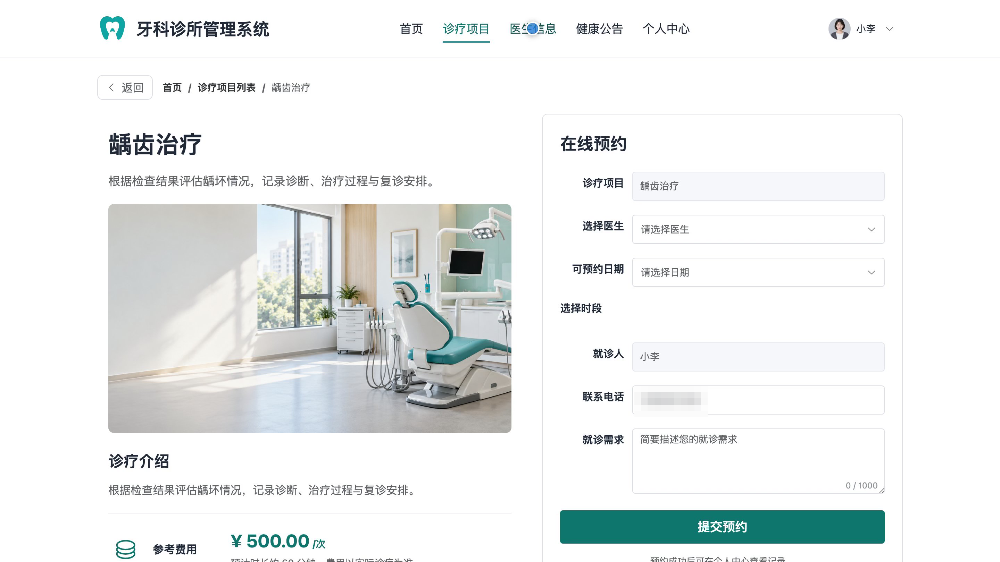
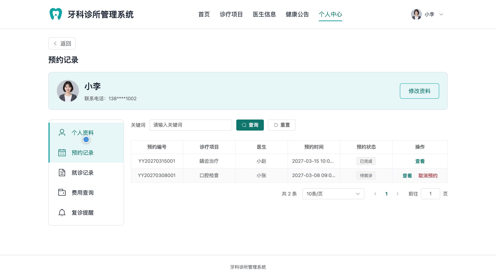
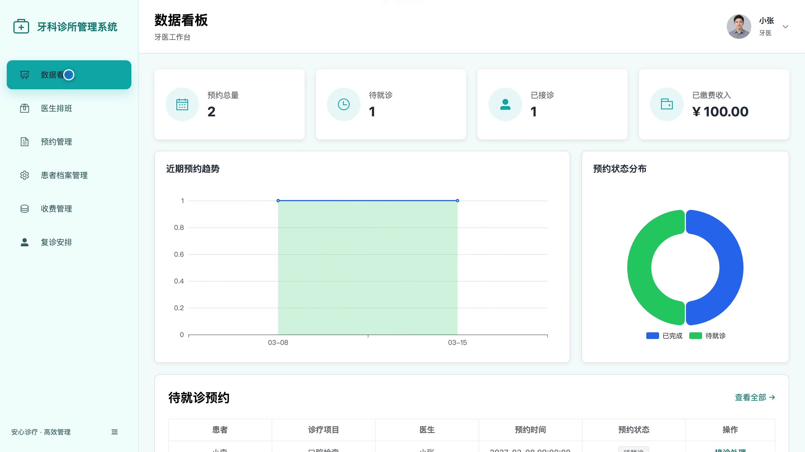
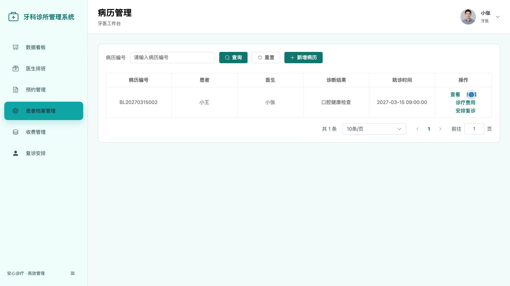
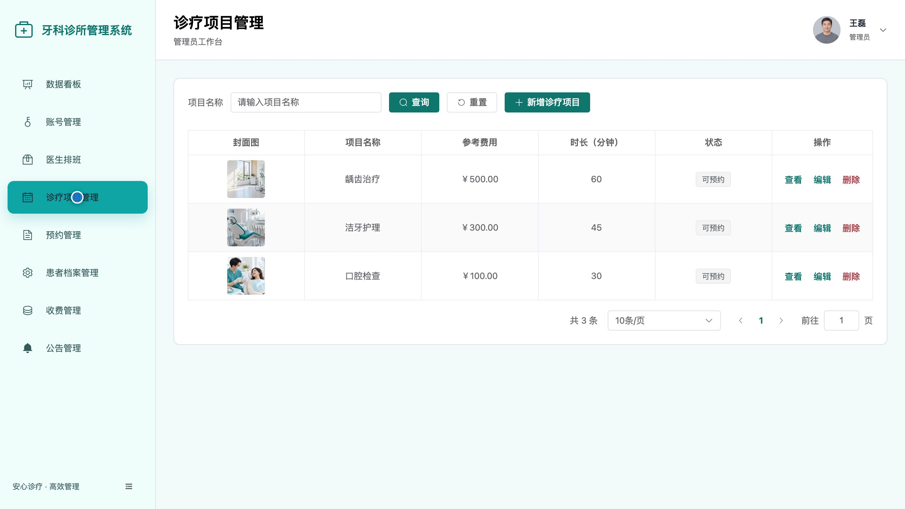
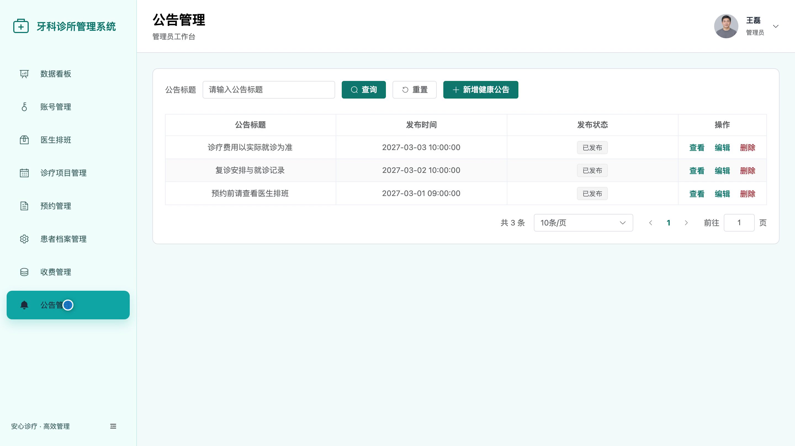

# bs152A
bs152A牙科诊所管理系统源码 Java SpringBoot3 Vue3 前后分离
## 源码问题查看主页咨询

### 一、关键词
口腔诊所、牙科预约、口腔诊疗、医生排班、就诊病历

### 二、作品包含
源码+数据库+全套环境和工具资源+本地部署教程

### 三、项目技术
前端技术： Html、Css、Js、Vue3.4、Element-Plus
后端技术：Java、SpringBoot3.2.0、MyBatis-Plus

### 四、运行环境要求
开发工具：IDEA/eclipse + VSCODE

数据库：MySQL5.7（共10张表）

数据库管理工具：Navicat10以上版本

环境配置软件： JDK17 + Maven3.6

前端Nodejs：16+

浏览器：谷歌浏览器

### 五、项目介绍
项目编号：bs152A

牙科诊所管理系统面向患者、牙医和管理员，围绕诊疗项目与医生信息展示、在线预约、医生排班、接诊病历、费用账单及复诊安排组织诊所业务。患者可查看服务并预约就诊，牙医处理接诊和病历，管理员维护项目、账号、公告及业务数据。

角色：患者、牙医、管理员

患者功能：诊疗项目与医生信息查看、在线预约与预约记录管理、就诊记录查看、费用查询、复诊提醒查看、个人资料管理。

牙医功能：预约接诊管理、医生排班管理、患者档案与病历管理、收费管理、复诊安排、个人资料管理。

管理员功能：诊疗项目管理、预约与医生排班管理、账号与患者档案管理、病历与收费管理、公告管理、数据看板查看。

### 六、运行截图

